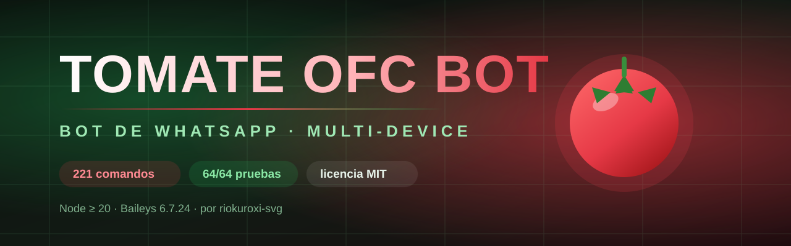

<div align="center">



<br>


<br>

[](https://github.com/Alx6767/Tomate-ofc-bot)


<sub>

**[Instalar](#-instalación-en-5-minutos)** ·
**[Comandos](#-los-221-comandos)** ·
**[Botones](#-botones-que-se-tocan)** ·
**[Descargas](#-descargas-sin-yt-dlp-obligatorio)** ·
**[Arte](#-arte-del-bot)** ·
**[Problemas](#-si-algo-no-funciona)** ·
**[Guía completa](docs/GUIA.md)**

</sub>

</div>

---

## 🍅 Qué es esto

Un bot de WhatsApp que se vincula como **dispositivo secundario** —sin API
oficial, sin cuenta de empresa, sin tarjeta— con **221 comandos**: menús con
botones nativos, economía, RPG, gacha, pokémon, minijuegos jugables, descargas de
YouTube y TikTok, administración de grupos e IA opcional.

Está escrito **desde cero**: no es un fork de otro bot. Los plugins se cargan
solos, la base de datos es un JSON (funciona en Termux sin compilar nada) y la
calculadora tiene su propio analizador para que nadie pueda ejecutar código por
el chat.

| | |
|---|---|
| **Comandos** | 221 únicos · 197 nombres con alias · 16 categorías |
| **Pruebas** | 64/64 (calculadora, datos, permisos y comandos) |
| **Node** | ≥ 20 |
| **Baileys** | 6.7.24 |
| **Datos** | JSON con guardado atómico y respaldo automático |
| **Licencia** | MIT |

## ⚡ Instalación en 5 minutos

```bash
git clone https://github.com/Alx6767/Tomate-ofc-bot
cd Tomate-ofc-bot
npm install
cp .env.example .env
npm start
```

1. En `.env` pon **tu número personal** en `OWNER` (solo dígitos, sin `+`).
2. `npm start` imprime un **QR** (o un código de 8 dígitos, si pones
   `PAIRING=code` y `PAIRING_NUMBER`).
3. En el teléfono: **Ajustes → Dispositivos vinculados → Vincular un
   dispositivo**.
4. Escríbele `.menu` desde tu número.

<details>
<summary><b>📱 Termux (Android) y dejarlo siempre encendido</b></summary>

```bash
pkg update && pkg install nodejs-lts git ffmpeg
git clone https://github.com/Alx6767/Tomate-ofc-bot && cd Tomate-ofc-bot
npm install && cp .env.example .env && npm start
```

```bash
npm install -g pm2
pm2 start index.js --name tomate && pm2 save
pm2 logs tomate        # ver qué pasa
pm2 restart tomate     # reiniciar
```

</details>

<details>
<summary><b>☁️ Railway, Render, Koyeb o VPS</b></summary>

Comando de arranque: `npm start`. Añade las variables del `.env` en el panel.
Para ver el QR, abre los **logs** del servicio.

En hostings gratuitos el disco se borra al reiniciar: monta un volumen en
`sesion/` y `data/`, o usa `PAIRING=code` para revincular rápido.

En un VPS con systemd hay un servicio listo en la [guía](docs/GUIA.md).

</details>

## 🎛️ Configuración que importa

Todo vive en `.env`. Estas son las claves que de verdad cambian el
comportamiento:

| Variable | Por defecto | Para qué |
|---|---|---|
| `OWNER` | — | **Tu** número. Sin esto nadie puede usar los comandos de dueño |
| `MODS` | vacío | Moderadores, separados por coma |
| `BOT_NAME` | `Tomate ofc bot` | Nombre que sale en el menú |
| `PREFIXES` | `.,!,/` | Prefijos aceptados |
| `PAIRING` | `qr` | `qr` (escanea) o `code` (8 caracteres) |
| `PAIRING_NUMBER` | vacío | Número que se vincula con `code` |
| `PRIVATE_MODE` | `false` | Solo el dueño y los mods usan el bot |
| `RATE_LIMIT` | `25` | Comandos por minuto y chat |
| `BOTONES` | `true` | Botones interactivos con respaldo a texto |
| `NSFW` | `false` | Comandos de adultos |
| `GEMINI_KEY` / `GROQ_KEY` / `OPENAI_KEY` | vacío | Claves de IA (opcionales) |

## 📚 Los 221 comandos

Escribe `.menu` dentro de WhatsApp. Los imprescindibles:

| Comando | Qué hace |
|---|---|
| `.menu` | menú por categorías, armado con los comandos que existen de verdad |
| `.help <comando>` | cómo se usa uno concreto |
| `.ping` | latencia, memoria y tiempo activo |
| `.botinfo` | versión, comandos cargados y estado |
| `.play <canción>` | busca y manda el audio |
| `.play2 <vídeo>` | busca y manda el vídeo |
| `.yts <búsqueda>` | busca y ofrece los botones de audio o vídeo |
| `.calc (12+8)*3` | calculadora con analizador propio (sin `eval`) |
| `.sticker` / `.toimg` | imagen a sticker y de vuelta |
| `.daily` · `.work` · `.minar` · `.pescar` | economía: gana tomates |
| `.snake` · `.pacman` · `.tetris` | juegos jugables de verdad, con emojis |
| `.gacha` · `.claim` · `.harem` | colecciona personajes |
| `.perfil` · `.marry` · `.familia` | tu ficha y tus vínculos |
| `.warn` · `.kick` · `.antilink` | moderación de grupos |
| `.code <número>` | sub-bot: otra cuenta desde el mismo proceso |

**Las 16 categorías:** menús · juegos & diversión · economía & RPG · útiles ·
perfil · descargas · owner · grupo · subbots · gacha · info · pokémon · IA ·
minijuegos · álbum · NSFW.

La lista completa, generada del registro real, está en
**[docs/COMANDOS.md](docs/COMANDOS.md)**.

## 🎛️ Botones que se tocan

Los comandos que lo merecen mandan **botones nativos**: respuesta, enlace y
copiar.

```
.tu número → .play me atrapaste

┌──────────────────────────────────┐
│  🎧 Audio                        │
│  Darío Gómez - Me Atrapaste      │
│  · Duración: 3:55                │
│                                  │
│  [ 🎧 Bajar audio ]              │
│  [ 🎬 Bajar vídeo ]              │
│  [ 🔗 Abrir en YouTube ]         │
└──────────────────────────────────┘
```

Al tocar uno, llega un comando al chat como si lo hubieras escrito. El manejador
entiende respuestas de **botón, lista y plantilla**, así que no hace falta una
tabla de callbacks.

**Y si el botón no sale** (WhatsApp viejo, cliente que no los acepta): el bot
manda el mismo contenido como texto numerado. Nunca se queda en «enviando…». Se
puede apagar con `BOTONES=false`.

## ⬇️ Descargas sin yt-dlp obligatorio

Aquí está la diferencia con casi todos los bots:

| | yt-dlp solo | Tomate ofc bot |
|---|---|---|
| En un teléfono (IP de casa) | funciona | funciona |
| En un VPS o hosting | ❌ *«Sign in to confirm you're not a bot»* | ✅ usa las fuentes por API |
| Si una fuente está caída | no hay plan B | prueba la siguiente |

**Cómo funciona:** busca con `yt-search` y pide el archivo a tres fuentes **en
orden**, comprobando cada entrega:

1. `@vreden/youtube_scraper`
2. `btch-downloader`
3. `yt-dlp`, si está instalado

¿Por qué comprobar? Porque un enlace puede devolver un HTML de error de 2 KB y
mandarlo como si fuera un mp3. Aquí se verifica que pese, que el tipo sea audio o
vídeo, y que no pase de **60 MB** ni de **25 minutos**.

Prueba real, con el bot tal cual:

```
.play me atrapate   →  MP3 de 3.57 MB en 8.3 s  · fuente: vreden
.play2 me atrapate  →  MP4 de 8.06 MB en 8.4 s  · fuente: vreden
```

`.ytinfo` muestra los datos y **qué fuentes están disponibles** en tu instalación.

## 🎨 Arte del bot

La mascota y el banner viven en `assets/` y se usan solos: `.foto` manda la
mascota, `.setbanner` el banner.

- `assets/banner.svg` — el banner del README (escala sin pixelarse)
- `assets/mascota.png` — la mascota
- `assets/tomate.jpg` — la foto de perfil del bot

Para cambiar la foto de perfil del número desde WhatsApp: cita una imagen y usa
`.setpfp` (solo dueño).

## 🔐 Lo que no hace (y por qué)

- **No ejecuta código desde el chat.** La calculadora es un analizador propio.
  Solo el comando `eval` del dueño ejecuta JavaScript, cada uso queda en consola
  y se puede borrar con el archivo `plugins/owner.js`.
- **No clona repositorios ajenos.** `gitclone` responde que está desactivado.
- **No finge descargas.** Si no hay fuente, dice qué falló en cada intento.
- **No enciende lo NSFW solo.** Viene apagado y hay que poner `NSFW=true`.

Detalles en **[docs/SEGURIDAD.md](docs/SEGURIDAD.md)**.

## 🗂️ Estructura

```
Tomate-ofc-bot/
├── index.js              arranque, conexión, reconexión y vinculación
├── src/
│   ├── config.js         lee el .env
│   ├── store.js          base JSON con guardado atómico
│   ├── handler.js        permisos, prefijos y ejecución
│   ├── loader.js         descubre y valida los plugins
│   ├── menu.js           arma el menú con los comandos reales
│   ├── botones.js        botones nativos con respaldo a texto
│   ├── fuentes.js        descargas: tres fuentes en orden
│   ├── ia.js             Gemini, Groq y OpenAI (opcionales)
│   ├── media.js          stickers y notas de voz (ffmpeg)
│   ├── calc.js           calculadora sin eval
│   └── subbots.js        otras cuentas desde el mismo proceso
├── plugins/              221 comandos, uno o varios por archivo
├── data/                 catálogo del gacha y la base tomate.json
├── assets/               banner, mascota y foto de perfil
├── test/                 64 pruebas
├── tools/                ver-menu y ver-comandos
└── docs/                 guía, comandos y seguridad
```

## 🔧 Si algo no funciona

| Síntoma | Qué pasa |
|---|---|
| Pide QR en cada arranque | `sesion/` no se guarda: falta volumen o disco persistente |
| `.play` no encuentra nada | escribe el nombre completo o pega el enlace |
| `.play` falla con «not a bot» | prueba otra vez; si sigue, pon el bot en un teléfono |
| Los stickers no salen | falta `ffmpeg` (`pkg install ffmpeg`) |
| Los botones no aparecen | cliente viejo: llega el texto numerado, escribe el comando |
| «Comando restringido» | ese comando es de dueño o de admin |
| Se queda callado en grupo | `RATE_LIMIT` (25 por minuto y chat) o espera del comando |

La lista larga, con lo que hay que hacer en cada caso, está en la
**[guía](docs/GUIA.md#16-problemas-frecuentes)**.

## 🧪 Pruebas

```bash
npm test          # 64 pruebas
npm run menu      # pinta el menú sin conectar WhatsApp
npm run check     # sintaxis de todos los archivos
```

Se ejecutan los comandos contra un WhatsApp falso: prefijos, permisos,
cooldown, respuestas, botones y los juegos. Si algo se rompe, se ve aquí antes
que en el grupo.

```bash
# resumen de la última pasada
# tests 64
# pass 64
# fail 0
```

## 🧩 Hacer tus propios comandos

Un plugin es un archivo en `plugins/` que exporta una lista. No hay que
registrarlo en ningún sitio:

```js
export default [
  {
    name: "saludo",
    aliases: ["hola"],
    category: "utils",
    desc: "Saluda.",
    run: async ({ reply }) => reply("🍅 Hola.")
  }
];
```

`npm run menu` debería mostrarlo. Todo lo que recibe un comando está explicado
en la [guía](docs/GUIA.md#18-hacer-tus-propios-comandos).

## 📄 Licencia y atribución

MIT — mira **[LICENSE](LICENSE)**. Úsalo, cámbialo y ponle tu nombre si quieres.

Hecho por **[riokuroxi-svg](https://github.com/riokuroxi-svg)** · sobre
[Baileys](https://github.com/WhiskeySockets/Baileys) · datos de pokémon de
[PokéAPI](https://pokeapi.co) · traducciones de
[MyMemory](https://mymemory.translated.net).

<div align="center">

**🍅 Si te sirvió, deja una estrella.**

</div>
