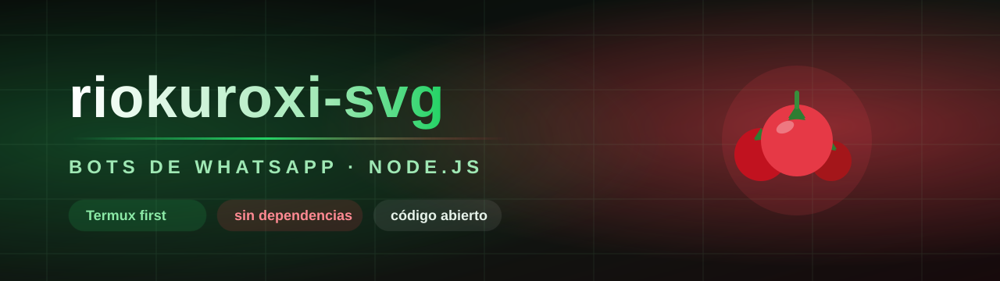

<!--
  WHOAMI / README de perfil para riokuroxi-svg

  Para publicarlo: crea un repositorio llamado EXACTAMENTE como tu usuario
  (riokuroxi-svg/riokuroxi-svg), público, y pega este README.md en la raíz.
  GitHub lo muestra arriba de tu perfil.

  Las imágenes apuntan a la carpeta docs/ de Tomate-ofc-bot. Si prefieres tenerlas
  en el repo del perfil, copia `perfil-banner.svg` y `mascota.png` a una carpeta
  `assets/` y cambia las rutas.
-->

 

 

**[Tomate ofc bot](https://github.com/Alx6767/Tomate-ofc-bot)** ·
**[Guía](https://github.com/Alx6767/Tomate-ofc-bot/blob/main/docs/GUIA.md)** ·
**[Comandos](https://github.com/Alx6767/Tomate-ofc-bot/blob/main/docs/COMANDOS.md)**

---

## 🍅 Quién soy

Escribo **bots de WhatsApp** en JavaScript (ESM) sobre Baileys. Mi regla es
simple: que funcione en un teléfono con Termux, sin compilar bases de datos ni
instalar media docena de programas, y que lo que promete el menú exista de
verdad detrás.

- 🔧 **Lo que hago:** bots completos — economía, RPG, gacha, juegos, descargas,
  moderación de grupos y botones nativos.
- 🧪 **Cómo trabajo:** cada cosa lleva su prueba. Si un comando dice que
  funciona, hay un test que lo demuestra antes de subirlo.
- 📵 **Lo que evito:** dependencias que solo compilan en x86, código ofuscado y
  `eval` en comandos que cualquiera puede escribir.

## 🚀 Lo que estoy construyendo

### 🍅 Tomate ofc bot

Bot de WhatsApp con **221 comandos** en 16 categorías, escrito desde cero.

| | |
|---|---|
| Comandos | 221 únicos · 197 alias |
| Pruebas | 64/64 |
| Descargas | tres fuentes en orden, con archivo comprobado |
| Datos | JSON con guardado atómico (funciona en Termux) |
| Licencia | MIT |

**[Ver el repositorio →](https://github.com/Alx6767/Tomate-ofc-bot)**

Lo que lo hace distinto:

- **Descargas que aguantan un servidor.** No dependen solo de yt-dlp: buscan y
  prueban varias fuentes hasta que una entregue el archivo de verdad.
- **Botones nativos** con respaldo automático a texto si el cliente no los pinta.
- **Juegos jugables** dentro del chat: serpiente, pacman, tetris, flappy y pong.
- **Cero `eval`** en comandos de usuarios: la calculadora tiene analizador propio.

## 🧰 Herramientas

## 📊 Mis números

## 💬 Cómo colaborar

1. Abre un **issue** contando qué falla (con el mensaje de error y qué comando
   era) o qué te gustaría que el bot hiciera.
2. Si vas a mandar código, que traiga su prueba: `npm test` tiene que seguir en
   verde.
3. Los pull requests pequeños y concretos se revisan más rápido que los grandes.

**🍅 Un tomate no se hace en un día. Un bot tampoco.**

